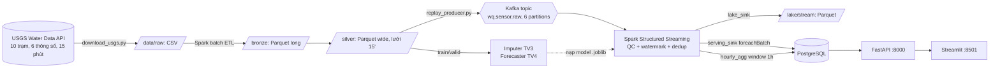
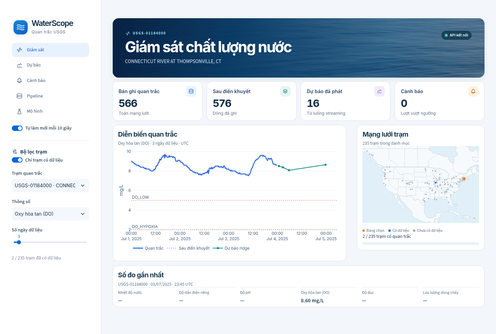

# Water Quality Monitoring, Imputation & Prediction — Big Data Pipeline

Hệ thống Big Data giám sát chất lượng nước từ **dữ liệu cảm biến liên tục (15 phút) của USGS**:
thu thập → xử lý batch & streaming bằng **Apache Spark** → truyền dữ liệu thời gian thực qua **Apache Kafka**
→ **điền khuyết** (imputation) và **dự báo** (prediction) online → phục vụ qua **FastAPI** + **Streamlit dashboard**,
triển khai bằng **Docker Compose**.

> Bài tập lớn môn Big Data — nhóm 4 thành viên. Tài liệu chi tiết nằm trong [`docs/`](docs/).

## Kiến trúc



Chi tiết thiết kế, lý do chọn công nghệ, sơ đồ triển khai: [`docs/architecture.md`](docs/architecture.md).

## Chạy nhanh (Docker)

Yêu cầu: Docker Desktop (Windows dùng WSL2), cấp cho Docker ≥ 4 CPU, ≥ 8 GB RAM.

```bash
docker compose build          # build image dự án (Python 3.12 + Spark 4.2.1 + connector Kafka/JDBC)
docker compose up -d          # tải dữ liệu USGS -> ETL -> Kafka -> Spark Streaming -> API -> Dashboard
docker compose ps
```

| Địa chỉ | Nội dung |
|---|---|
| http://localhost:8501 | Dashboard giám sát / dự báo / cảnh báo / pipeline |
| http://localhost:8000/docs | REST API (Swagger) |
| http://localhost:8080 | Spark Master UI (2 worker) |
| http://localhost:4040 | Spark UI của ứng dụng streaming (tab Structured Streaming) |
| `docker compose --profile tools up -d kafka-ui` → http://localhost:8090 | Kafka UI |

Lệnh hay dùng: `make help` (hoặc xem [`Makefile`](Makefile)). Chạy lại demo từ đầu: `./scripts/reset_stream.sh`.

### Chế độ Big Data đầy đủ: 235 trạm + HDFS + Spark cluster

```bash
docker compose --env-file .env.bigdata up -d
```

Bật thêm HDFS (1 NameNode + 2 DataNode, http://localhost:9870), tải 235 trạm USGS về landing zone, nạp lên HDFS,
chạy ETL trên cụm Spark, streaming đặt checkpoint trên HDFS. Cần Docker ≥ 6 CPU / 12 GB RAM; lần tải đầu mất lâu
do giới hạn tốc độ của API USGS (script tự tiếp tục từ chỗ dừng). Chi tiết: [`docs/architecture.md`](docs/architecture.md).



## Kết quả nổi bật (máy thử 4 vCPU — xem [`benchmarks/README.md`](benchmarks/README.md))

| Hạng mục | Kết quả |
|---|---|
| Batch ETL 23,8 triệu giá trị | 139 s (1 core) → 49 s (4 core), tăng tốc 2,84×; 47,7 triệu giá trị trong 112 s |
| Streaming Kafka → Spark → PostgreSQL | bền vững tới 8.000 msg/s, độ trễ p50 3,3 s / p95 4,0 s; trần ≈ 18.000 bản ghi/s |
| Chịu lỗi | kill Spark giữa chừng + 1% dữ liệu trễ + 0,5% trùng ⇒ 0 mất, 0 trùng (2.866/2.866 bản ghi) |

## Cấu trúc thư mục & người phụ trách

| Thư mục | Nội dung | Phụ trách |
|---|---|---|
| `wq/contracts.py`, `docs/data_contract.md` | Data contract dùng chung (tên cột, đơn vị, ngưỡng, split, Kafka schema) | TV1 |
| `ingestion/download_usgs.py` | Tải dữ liệu USGS (OGC API) | TV2 (TV1 dựng khung) |
| `batch/etl_usgs.py` | Spark batch ETL raw → bronze → silver → gold | TV2 (TV1 dựng khung) |
| `ingestion/replay_producer.py` | Kafka producer phát lại dữ liệu như cảm biến thật | TV1 |
| `streaming/stream_processor.py` | Spark Structured Streaming (QC, watermark, dedup, sink, ML online, metrics) | TV1 |
| `wq/models/base.py`, `registry.py` | Interface mô hình + nạp model theo cấu hình | TV1 |
| `wq/models/baselines.py` | Baseline LOCF / nội suy / persistence / seasonal-naive | TV1 → TV3, TV4 so sánh |
| `wq/models/imputers_*.py`, `notebooks/` | Mô hình điền khuyết + thí nghiệm che dữ liệu | TV3 |
| `wq/models/forecasters_*.py`, `notebooks/` | Mô hình dự báo (XGBoost/LSTM) + đánh giá | TV4 |
| `api/`, `dashboard/` | FastAPI + Streamlit | TV1 (khung) + TV2 (trang giám sát) |
| `docker-compose.yml`, `docker/`, `deploy/` | Triển khai | TV1 |
| `benchmarks/` | Đo hiệu năng batch/streaming | TV1 |
| `wq/models/validate.py` | Kiểm tra mô hình TV3/TV4 bàn giao trước khi tích hợp | TV1 |
| `batch/ingest_hdfs.py`, `wq/io.py` | Nạp dữ liệu lên HDFS; đọc data lake (local hoặc HDFS) thành pandas | TV1 |
| `tests/` | Unit test (pytest) | cả nhóm |

## Tài liệu

- [`docs/TEAM_TASKS.md`](docs/TEAM_TASKS.md) — **việc, tiêu chí đạt và trạng thái của TV2, TV3, TV4**; quy trình PR và review tự động
- [`docs/TV1_GUIDE.md`](docs/TV1_GUIDE.md) — **hướng dẫn từng bước cho TV1** (chạy, hiểu, làm tiếp, demo, Q&A bảo vệ)
- [`docs/team_plan.md`](docs/team_plan.md) — phân công chi tiết, sản phẩm bàn giao, lịch 4 tuần
- [`docs/01_danh_gia_tai_lieu.md`](docs/01_danh_gia_tai_lieu.md) — đánh giá 2 bài báo tham khảo + bài mẫu BKByte
- [`docs/architecture.md`](docs/architecture.md) — kiến trúc & quyết định thiết kế
- [`docs/data_contract.md`](docs/data_contract.md) — hợp đồng dữ liệu giữa các module
- [`docs/kickoff_tv1.md`](docs/kickoff_tv1.md) — chương trình họp khởi động, các quyết định cần chốt
- [`docs/report/`](docs/report/) — bản nháp các chương báo cáo TV1 phụ trách
- [`benchmarks/README.md`](benchmarks/README.md) — phương pháp & kết quả đo hiệu năng

## Dữ liệu

USGS Water Data OGC API (`api.waterdata.usgs.gov`, collection `continuous`), 10 trạm sông tại Mỹ,
2023-01-01 → 2025-12-31, 6 thông số: nhiệt độ nước (00010), độ dẫn điện (00095), pH (00400),
oxy hòa tan DO (00300), độ đục (63680), lưu lượng (00060). Khoảng **5,96 triệu giá trị đo** thô →
**1.052.160 dòng** silver (lưới 15 phút). Danh sách trạm: [`config/stations.json`](config/stations.json).
Chia theo thời gian: train 2023–2024, valid 2025 H1, test 2025 H2 (streaming demo phát lại giai đoạn test).
