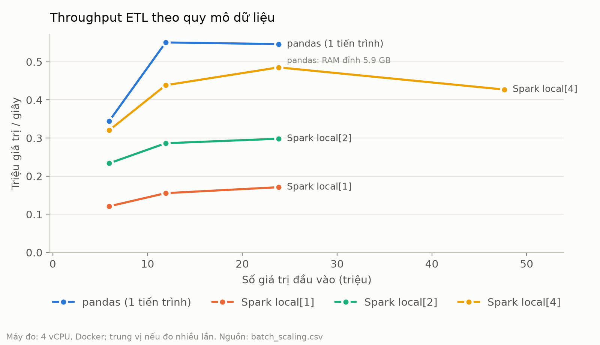
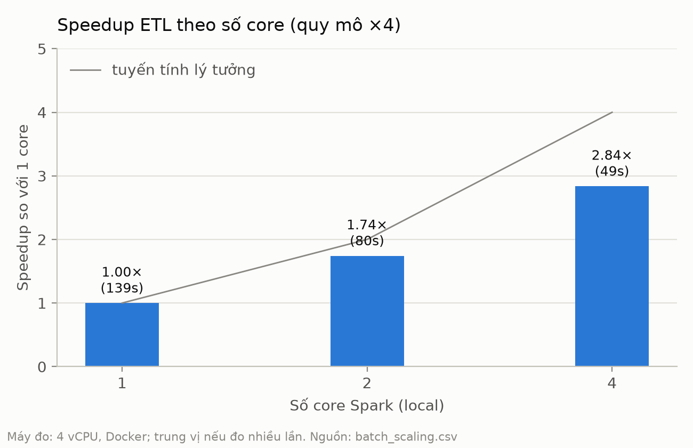
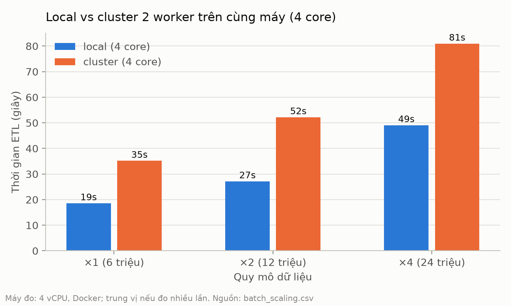
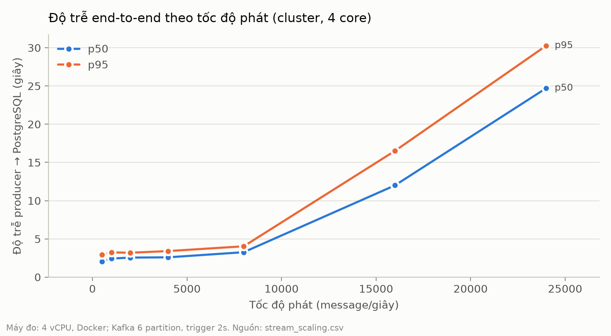
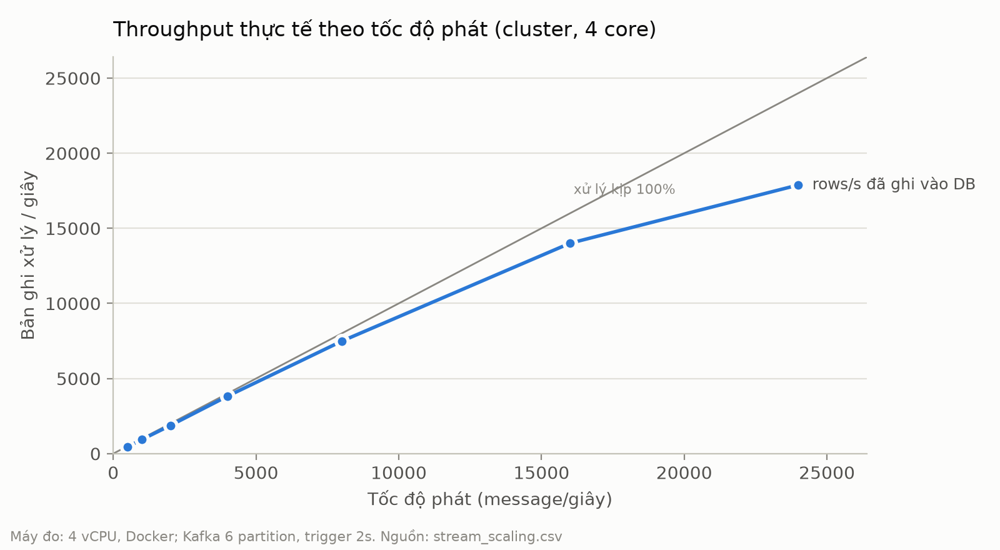

# Benchmark hiệu năng (Big Data Performance) — TV1

Mục tiêu: trả lời bằng **số liệu đo được** (không phải mô tả định tính) ba câu hỏi:

1. **Batch:** thời gian/thông lượng ETL thay đổi thế nào khi tăng **kích thước dữ liệu** và **số core**? Spark so với pandas đơn tiến trình thì sao? Chạy cluster (2 worker) khác local thế nào?
2. **Streaming:** hệ thống chịu được **tốc độ dữ liệu** bao nhiêu message/giây mà độ trễ vẫn ổn định? Độ trễ end-to-end p50/p95 là bao nhiêu?
3. **Chi phí ML online:** điền khuyết + dự báo trong mỗi micro-batch tốn thêm bao nhiêu thời gian?

## Cách chạy

Chạy trong container (cùng môi trường với hệ thống). Tắt producer/stream demo trước để không tranh CPU.

```bash
docker compose stop producer stream-processor
```

```bash
docker compose run --rm --no-deps -e WQ_DRIVER_MEMORY=6g data-init python -m benchmarks.bench_batch --scales 1 2 4 --cores 1 2 4 --cluster spark://spark-master:7077 --cluster-cores 2 4
```

```bash
docker compose run --rm --no-deps data-init python -m benchmarks.bench_streaming --master spark://spark-master:7077 --cores 4 --rates 500 1000 2000 4000 8000 --duration 45
```

```bash
docker compose run --rm --no-deps data-init python -m benchmarks.plot_results
```

Dữ liệu thật quy mô lớn (chế độ Big Data, cần profile `hdfs`): tải bộ trạm lớn, nạp lên HDFS rồi chạy
`bench_large` (pandas → Spark local[4] → cụm Spark 4 core đọc/ghi HDFS):

```bash
docker compose --env-file .env.bigdata up -d namenode datanode-1 datanode-2 spark-master spark-worker-1 spark-worker-2
```

```bash
docker compose --env-file .env.bigdata run --rm --no-deps producer python -m batch.ingest_hdfs
```

```bash
docker compose --env-file .env.bigdata run --rm --no-deps -e WQ_DRIVER_MEMORY=6g producer python -m benchmarks.bench_large
```

```bash
docker compose --env-file .env.bigdata run --rm --no-deps producer python -m benchmarks.bench_streaming --master spark://spark-master:7077 --cores 4 --rates 1000 4000 --duration 45 --ml --out benchmarks/results/stream_large.csv
```

Kết quả được **nối thêm** (append) vào `benchmarks/results/batch_scaling.csv` và `stream_scaling.csv`
(chạy lại nhiều lần ⇒ biểu đồ lấy trung vị). Ghi rõ cấu hình máy khi đưa vào báo cáo.

## Phương pháp

**Batch** (`bench_batch.py`): chạy đúng hàm `batch.etl_usgs.run_etl` (đọc 180 file CSV → bronze → silver lưới
15 phút → gold) và ghi Parquet thật. `--scale k` nhân bản số trạm k lần trong Spark (×1 = 5,96 triệu giá trị đầu
vào, ×4 = 23,8 triệu). pandas baseline làm cùng logic trên một tiến trình. Thông lượng = số giá trị đầu vào / tổng
thời gian (gồm cả khởi động job, không gồm khởi động JVM).

**Streaming** (`bench_streaming.py`): mỗi mức tốc độ R dùng topic Kafka mới, checkpoint mới và database riêng
`wq_bench`. Stream processor thật (query `serving_sink`, trigger 2 s) chạy trên cluster; producer phát đúng R
message/giây trong D giây rồi dừng; script chờ đến khi Spark xử lý hết backlog. Đo:
- *throughput* = số bản ghi đã ghi vào PostgreSQL / (thời gian phát + thời gian xả backlog);
- *độ trễ end-to-end* = thời điểm micro-batch ghi xong vào PostgreSQL − thời điểm producer gửi (`producer_ts`),
  lấy trung vị p50 và phân vị p95 qua các micro-batch (bỏ batch khởi động);
- *drain_s* = thời gian còn phải xử lý sau khi producer dừng (≈ 0 nghĩa là theo kịp).
Một mức R được coi là **bền vững** nếu throughput ≈ R, drain ≈ 0 và p95 không tăng dần theo thời gian.

## Kết quả mẫu

Đo trên máy chạy thử **4 vCPU, 15 GB RAM** (mọi container dùng chung 4 vCPU này). Nhóm cần **chạy lại trên máy của
nhóm** và thay số liệu; xu hướng mới là điều cần phân tích.

<!-- RESULTS_START -->
### Batch ETL (giây; giá trị đầu vào = số điểm đo thô)

| Cấu hình | ×1 (5,96 triệu) | ×2 (11,9 triệu) | ×4 (23,8 triệu) | ×8 (47,7 triệu) |
|---|---|---|---|---|
| pandas (1 tiến trình) | **17,3** | **21,6** | **43,6** (RAM đỉnh 5,9 GB) | không chạy (ước tính ~12 GB RAM) |
| Spark local[1] | 49,2 | 76,6 | 139,3 | — |
| Spark local[2] | 25,5 | 41,6 | 79,9 | — |
| Spark local[4] | 18,6 | 27,2 | 49,1 | 111,5 |
| Spark cluster, 2 core | 40,1 | 62,4 | 103,4 | — |
| Spark cluster, 4 core | 35,2 | 52,2 | 81,0 | — |

- Speedup theo core ở ×4: 1,74× (2 core), **2,84×** (4 core) — hiệu suất song song 71%.
- pandas nhanh hơn khi dữ liệu vừa RAM nhưng bộ nhớ tăng tuyến tính; Spark xử lý ×8 với bộ nhớ driver giới hạn 6 GB.
- Cluster 2 worker *trên cùng máy* chậm hơn local 1,65–1,9× (chi phí mạng/tuần tự hóa); khoảng cách thu hẹp khi dữ liệu lớn.





### Dữ liệu thật quy mô lớn: 56 trạm, 34,2 triệu giá trị (`bench_large.py` → `results/batch_large.csv`)

Bộ trạm lớn chốt ở 56 trạm thật (15 bang và Puerto Rico), 970 tệp CSV gzip, 108,6 MB; 5.892.096 dòng silver.

| Cấu hình | Dữ liệu thô / data lake | Thời gian (s) | Giá trị/s | Bộ nhớ |
|---|---|---|---|---|
| pandas, 1 tiến trình | đĩa cục bộ / đĩa cục bộ | **85,5** | 399.700 | RSS đỉnh **9,4 GB** (60% RAM máy) |
| Spark local[4] | đĩa cục bộ / đĩa cục bộ | 104,8 | 326.200 | driver giới hạn 6 GB |
| Spark cluster, 4 core | HDFS / HDFS | 153,7 | 222.400 | 2 worker × 2 GB |

- pandas vẫn nhanh hơn khi còn vừa RAM, nhưng 9,4 GB cho 34 triệu giá trị; đủ 235 trạm (~143 triệu) ước tính ~40 GB.
- Cluster + HDFS chậm hơn local 1,47× (bộ chuẩn: 1,89×): chi phí cố định của cụm được chia cho nhiều dữ liệu hơn.
- Dữ liệu thật chậm hơn dữ liệu nhân bản (326 nghìn so với 485 nghìn giá trị/s ở local[4]) do giải nén gzip và 970 tệp nhỏ.

### HDFS so với đĩa cục bộ (bộ chuẩn 5,96 triệu giá trị, Spark local[4])

| Nơi ghi data lake | Thời gian (s) | Trên đĩa |
|---|---|---|
| Đĩa cục bộ | 18,6 | 52,7 MiB |
| HDFS, replication 2 | 45,9 | 104,7 MiB (52,4 MiB × 2) |

`hdfs fsck`: HEALTHY, block trung bình < 1 MB so với block 128 MB (nhiều tệp nhỏ).

### Streaming 56 trạm thật, bật ML (`bench_streaming.py --ml` → `results/stream_large.csv`)

| Tốc độ phát | Số trạm | Xử lý / đã phát | Throughput | p50 | p95 | Micro-batch | Xả backlog |
|---|---|---|---|---|---|---|---|
| 1.000 msg/s | 10 | — | 936 | 3,5 s | 5,0 s | 3,1 s | — |
| 1.000 msg/s | 56 | 45.000 / 45.000 | 918 | 7,7 s | 11,6 s | 6,9 s | 4,0 s |
| 4.000 msg/s | 56 | 180.000 / 180.000 | 3.448 | 15,8 s | 23,7 s | 13,6 s | 7,2 s |

- Không mất bản ghi; chi phí ML tăng theo số trạm (một nhóm pandas mỗi trạm mỗi micro-batch).
- Lần chạy đầu lộ lỗi kiểu dữ liệu khi một trạm không có DO; đã sửa và có test hồi quy.

### Streaming Kafka → Spark (cluster 4 core, trigger 2 s) → PostgreSQL

| Tốc độ phát (msg/s) | Bản ghi xử lý | Throughput (rows/s) | Độ trễ p50 | Độ trễ p95 | Thời gian micro-batch (trung vị) | Xả backlog sau khi dừng phát | Đánh giá |
|---|---|---|---|---|---|---|---|
| 500 | 22.500 | 459 | 2,1 s | 3,0 s | 1,0 s | 4,0 s | theo kịp |
| 1.000 | 45.000 | 936 | 2,4 s | 3,2 s | 1,3 s | 3,1 s | theo kịp |
| 2.000 | 90.000 | 1.875 | 2,6 s | 3,2 s | 1,3 s | 3,0 s | theo kịp |
| 4.000 | 180.000 | 3.822 | 2,6 s | 3,4 s | 1,5 s | 2,1 s | theo kịp |
| 8.000 | 360.000 | 7.484 | 3,3 s | 4,0 s | 1,8 s | 3,1 s | theo kịp |
| 16.000 | 720.000 | 14.008 | 12,0 s | 16,5 s | 8,3 s | 6,4 s | **quá tải** (batch > trigger) |
| 24.000 | 1.049.895 | 17.886 | 24,7 s | 30,3 s | 14,0 s | 14,9 s | quá tải — trần ≈ 18 nghìn rows/s |
| 1.000 + ML online | 45.000 | 936 | 3,5 s | 5,0 s | 3,1 s | 3,1 s | theo kịp; ML thêm ~1,1 s/batch |

- Hệ thống **bền vững tới ít nhất 8.000 msg/s** (p95 ≤ 4 s); điểm gãy nằm giữa 8.000 và 16.000 msg/s, khi thời gian
  xử lý một micro-batch vượt chu kỳ trigger nên hàng đợi tích lũy và độ trễ tăng nhanh.
- Quy đổi (ngoại suy, chỉ xét đường dữ liệu chính, chưa tính ML): 1 trạm gửi 1 bản ghi/15 phút = 1/900 msg/s, nên
  8.000 msg/s tương đương ~**7,2 triệu trạm** cùng tần suất (8.000 × 900) trên 1 máy 4 vCPU. Khi bật ML, chi phí
  điền khuyết/dự báo tăng theo số trạm nên năng lực thực tế thấp hơn — cần đo thêm nếu nhóm muốn nêu con số này.




### Kiểm chứng tính đúng (late/duplicate + dừng đột ngột tiến trình xử lý)

Phát 3 ngày dữ liệu (01–03/07/2025, 10 trạm) ở 3600×, bơm 1% message trễ (0,5–3 s thực ≈ 30–180 phút dữ liệu) và
0,5% message trùng; giữa chừng `docker compose kill stream-processor`, 20 giây sau bật lại.

| Chỉ số | Giá trị |
|---|---|
| Bản ghi lẽ ra phải đến (silver) | 2.866 |
| Message trong Kafka | 2.876 (+10 bản trùng cố ý) |
| Dòng trong PostgreSQL / trùng khóa | **2.866 / 0** |
| Thiếu / thừa | **0 / 0** |
| Dòng trong data lake Parquet / phân biệt | 2.866 / 2.866 (exactly-once), nhưng 199 file nhỏ |
| Message trễ cố ý / bị watermark loại | 32 / 0 |

Sau khi khởi động lại, Spark đọc offset từ checkpoint và **chạy lại micro-batch đang dở** (batch 2); nhờ upsert
idempotent nên không phát sinh bản ghi trùng. Không message trễ nào bị loại vì watermark chỉ đảm bảo *không loại*
dữ liệu trễ ít hơn ngưỡng 2 giờ; dữ liệu trễ hơn *có thể* vẫn được nhận nếu đến trước khi watermark của micro-batch
kế tiếp vượt qua nó (ở đây backlog sau sự cố được xử lý trong cùng một batch).
<!-- RESULTS_END -->
