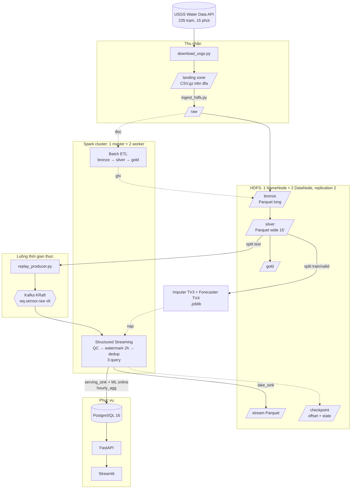
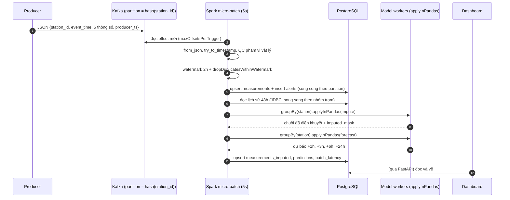
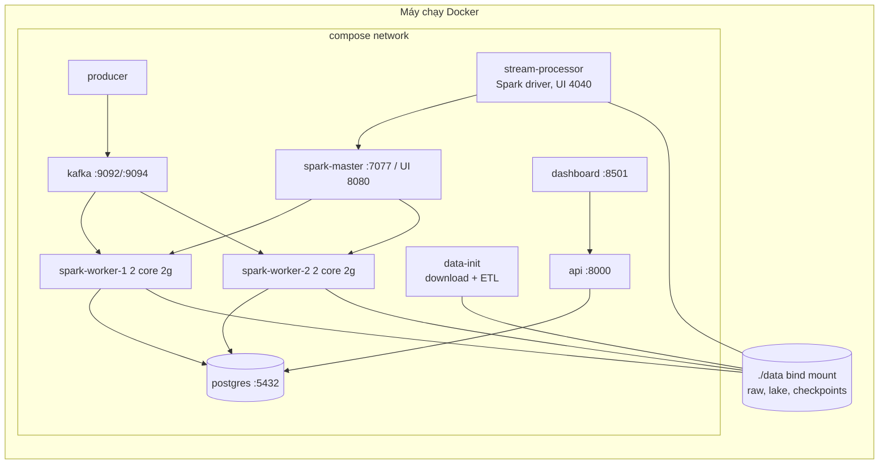
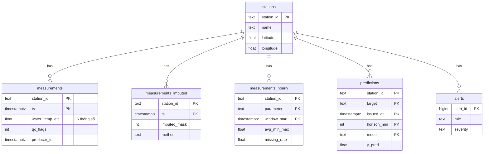

# Kiến trúc hệ thống (TV1)

## 1. Tổng quan

Hệ thống theo kiến trúc **Lambda rút gọn**: *batch layer* (Spark ETL trên dữ liệu lịch sử → dữ liệu huấn luyện
cho TV3/TV4) và *speed layer* (Kafka + Spark Structured Streaming trên dữ liệu "thời gian thực"). Hai lớp dùng
**chung một data contract và chung code QC** (`wq/contracts.py`, `wq/spark_transforms.py`) nên dữ liệu
huấn luyện và dữ liệu phục vụ nhất quán với nhau.

Hệ thống có **hai chế độ chạy cùng một mã nguồn**, chọn bằng biến môi trường:

| | Chế độ phát triển (mặc định) | Chế độ Big Data đầy đủ (`--env-file .env.bigdata`) |
|---|---|---|
| Dữ liệu | 10 trạm chuẩn (5,96 triệu giá trị) | 235 trạm USGS có đủ 5 thông số (mục tiêu ~118 triệu giá trị) |
| Lưu trữ data lake + checkpoint | Thư mục `./data` chia sẻ | **HDFS** (`hdfs://namenode:8020/wq/...`), replication 2 |
| Batch ETL | Spark `local[2]` | Spark **cluster** (`spark://spark-master:7077`) |
| Máy cần | ≥ 4 CPU, 8 GB RAM | ≥ 6 CPU, 12 GB RAM |
| Dùng cho | TV2/TV3/TV4 phát triển, thí nghiệm ML | Demo Big Data, benchmark hiệu năng (TV1) |

## 2. Thành phần và lý do lựa chọn

| Thành phần | Công nghệ | Vì sao chọn | Phương án thay thế đã cân nhắc |
|---|---|---|---|
| Nguồn dữ liệu | USGS OGC API (`/collections/continuous`) | Dữ liệu cảm biến thật, 15 phút, công khai, có khoảng thiếu tự nhiên (0,1–18%) | Bộ dữ liệu của bài báo (2) chỉ cung cấp theo yêu cầu |
| Message broker | Apache Kafka 4.3 (KRaft) | Log bền vững, đọc lại được (replay), phân vùng theo key → song song + giữ thứ tự theo trạm | MQTT (nhẹ nhưng không lưu log để replay) |
| Xử lý batch | PySpark 4.2 | Chung engine với streaming, chạy được local lẫn cluster | pandas (nhanh ở dữ liệu nhỏ — xem benchmark) |
| Xử lý stream | Spark Structured Streaming | Event-time, watermark, state, exactly-once với checkpoint, tái dùng code batch | Flink (mạnh hơn về độ trễ nhưng thêm 1 công nghệ) |
| Lưu trữ phân tán | HDFS 3.5 (1 NameNode, 2 DataNode) | Chuẩn của hệ sinh thái Hadoop; block + nhân bản chịu lỗi; Spark đọc/ghi trực tiếp; nơi đặt checkpoint streaming | S3/MinIO (đổi `WQ_LAKE_PATH` sang `s3a://`) |
| Data lake | Parquet (medallion bronze/silver/gold) | Nén cột, đọc chọn cột, phân vùng theo trạm | Delta Lake/Iceberg (hướng phát triển) |
| Serving DB | PostgreSQL 16 | Truy vấn theo trạm + khoảng thời gian, upsert `ON CONFLICT` | TimescaleDB (hướng phát triển) |
| API | FastAPI | Tự sinh tài liệu OpenAPI, nhẹ | Flask |
| Dashboard | Streamlit + Plotly | Làm nhanh bằng Python, đủ cho demo | React (tốn công frontend) |
| Triển khai | Docker Compose | 1 lệnh chạy toàn hệ thống, tái lập trên máy mọi thành viên | Kubernetes (quá mức cần thiết cho BTL) |

## 3. Luồng dữ liệu của một bản ghi

## 4. Quyết định thiết kế quan trọng (để viết báo cáo & bảo vệ)

1. **Key Kafka = `station_id`, 6 partition.** Mọi bản ghi của một trạm vào cùng partition ⇒ giữ thứ tự theo
   trạm; 6 partition ⇒ Spark đọc song song tối đa 6 task. Muốn mở rộng: tăng partition + thêm executor.
2. **Event-time + watermark 2 giờ.** Thời gian xử lý dựa trên thời điểm đo (`event_time`), không phải lúc nhận.
   Dữ liệu trễ ≤ 2h vẫn được tính; trễ hơn bị loại và state cũ được dọn ⇒ bộ nhớ không phình.
   Producer cố ý bơm **1% message trễ** và **0,5% message trùng** để chứng minh cơ chế hoạt động.
3. **Khử trùng lặp `dropDuplicatesWithinWatermark(station_id, event_time)`** (Spark ≥ 3.5).
4. **Exactly-once hiệu quả = checkpoint + sink idempotent.** Offset Kafka và state được lưu trong checkpoint;
   khi sự cố, Spark chạy lại micro-batch dở dang (at-least-once). Mọi lần ghi PostgreSQL là
   `INSERT … ON CONFLICT DO UPDATE/NOTHING` theo khóa chính ⇒ ghi lặp không sinh sai lệch.
   File sink Parquet có log `_spark_metadata` ⇒ exactly-once.
5. **Ghi DB từ executor (`foreachPartition`)**, không gom về driver ⇒ băng thông ghi tăng theo số executor.
6. **ML online phân tán theo trạm** bằng `groupBy("station_id").applyInPandas(...)`: mỗi trạm là một nhóm độc
   lập, Spark chia các nhóm cho executor ⇒ thêm trạm thì thêm máy. Mô hình được nạp **một lần mỗi Python worker**
   (cache), không nạp lại mỗi batch.
7. **Chỉ imputer *causal* được dùng online.** Streaming không biết tương lai ⇒ chỉ dùng phương pháp *filtering*
   (LOCF, Kalman filter, suy diễn tiến của DBN…). Phương pháp *smoothing* (nội suy 2 phía, MICE trên cả chuỗi)
   chỉ dùng offline. Interface có thuộc tính `causal` để kiểm soát.
8. **Một data contract, một code QC cho batch & streaming** ⇒ tránh *training/serving skew*.
9. **Bài học Spark 4:** ANSI mode bật mặc định ⇒ `to_timestamp('rác')` **ném lỗi làm sập query**.
   Dùng `try_to_timestamp` / `try_cast` (unit test `test_parse_messages_handles_nulls_and_garbage`).
10. **Parquet `TIMESTAMP_MICROS` (UTC)** thay vì INT96 mặc định ⇒ pandas/pyarrow của TV3/TV4 đọc đúng múi giờ.
11. **Small files problem:** sink Parquet streaming tạo nhiều file nhỏ ⇒ trigger 30s cho lake sink; hướng phát
    triển: job compaction định kỳ hoặc Delta Lake `OPTIMIZE`.
12. **Giám sát pipeline:** `StreamingQueryListener` ghi `numInputRows`, `processedRowsPerSecond`, watermark,
    số dòng state… vào bảng `stream_progress`; serving sink ghi độ trễ end-to-end vào `batch_latency`.

## 5. Sơ đồ triển khai (Docker Compose)

- **Driver** (`stream-processor`) chạy ở *client mode*, executor chạy trên 2 worker; `spark.driver.host`
  được đặt để executor kết nối ngược về driver.
- **`./data` là thư mục chia sẻ** giữa driver và mọi executor (checkpoint + data lake bắt buộc phải dùng chung).
  Trên cluster thật thay bằng HDFS/S3/MinIO (chỉ cần đổi `WQ_LAKE_PATH`, `WQ_CHECKPOINT_PATH`).
- **Một image dùng chung** cho mọi service Python/Spark ⇒ driver và executor có cùng phiên bản Python/thư viện
  (bắt buộc với PySpark UDF / `applyInPandas`).

## 6. Mô hình dữ liệu phục vụ (PostgreSQL)

Hai bảng giám sát: `stream_progress` (mỗi micro-batch mỗi query) và `batch_latency` (độ trễ end-to-end).
