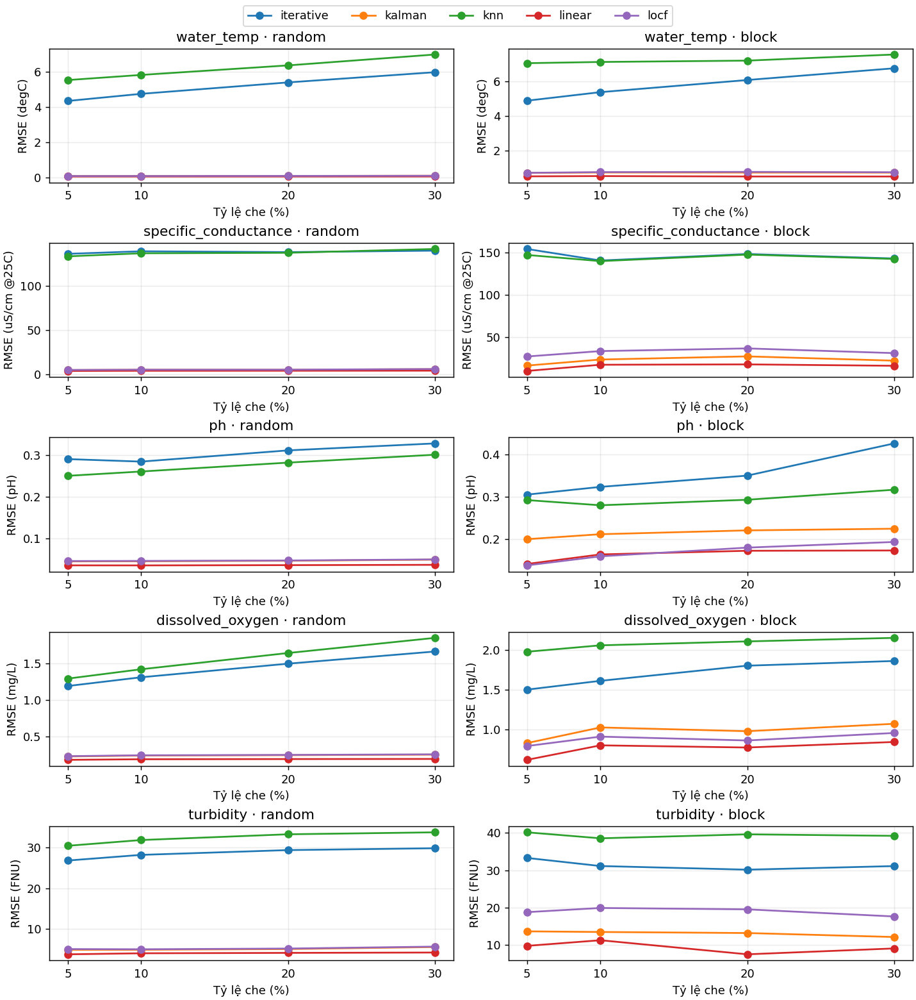

# Chương 5. Thực nghiệm điền khuyết dữ liệu quan trắc

## 5.1 Kết quả điền khuyết

Kết quả DO chính của Chương 5 xét 235 trạm. Phần dưới ghi lại thực nghiệm đối chiếu ban đầu trên 10 trạm cho cả năm biến. [Bảng validation và test trên bộ 235 trạm](validation_va_test_do.md)

### Phạm vi và cách đọc kết quả

Thực nghiệm trên tập test nửa cuối năm 2025 gồm 176.640 dòng từ 10 trạm USGS. Mỗi phương pháp chạy với hai kiểu thiếu, bốn tỷ lệ che, năm biến và ba seed (42, 43, 44), tạo 600 dòng kết quả. Các bảng dưới đây lấy trung bình ba seed trong từng tổ hợp. Sai số được tính trên các ô bị che mà phương pháp điền được, nên cần đọc cùng độ bao phủ. [Giao thức thí nghiệm](ch4_dien_khuyet_tv3.md) · [CSV benchmark](../../models/results_imputation.csv)

*Hình 5.1a. RMSE trung bình của ba seed theo phương pháp, tỷ lệ che và biến.* Hai cột lần lượt là che ngẫu nhiên và che theo khối. Mỗi biến có trục RMSE theo đơn vị riêng. Nguồn là [CSV benchmark](../../models/results_imputation.csv).

### Phương pháp có RMSE thấp nhất theo từng kịch bản

| Kiểu che | Tỷ lệ | Nhiệt độ (°C) | Độ dẫn điện (µS/cm ở 25 °C) | pH | DO (mg/L) | Độ đục (FNU) |
|---|---:|---:|---:|---:|---:|---:|
| Ngẫu nhiên | 5% | Linear · 0,0484 | Linear · 4,1472 | Linear · 0,0350 | Linear · 0,1779 | Linear · 3,8086 |
| Ngẫu nhiên | 10% | Linear · 0,0490 | Linear · 4,3515 | Linear · 0,0349 | Linear · 0,1861 | Linear · 4,0588 |
| Ngẫu nhiên | 20% | Linear · 0,0493 | Linear · 4,4070 | Linear · 0,0355 | Linear · 0,1888 | Linear · 4,1579 |
| Ngẫu nhiên | 30% | Linear · 0,0507 | Linear · 4,4685 | Linear · 0,0362 | Linear · 0,1902 | Linear · 4,2446 |
| Theo khối | 5% | Linear · 0,5257 | Linear · 10,3699 | LOCF · 0,1383 | Linear · 0,6171 | Linear · 9,7577 |
| Theo khối | 10% | Linear · 0,5413 | Linear · 17,6796 | LOCF · 0,1596 | Linear · 0,7997 | Linear · 11,2627 |
| Theo khối | 20% | Linear · 0,5185 | Linear · 18,1031 | Linear · 0,1727 | Linear · 0,7724 | Linear · 7,5010 |
| Theo khối | 30% | Linear · 0,5174 | Linear · 16,4651 | Linear · 0,1734 | Linear · 0,8422 | Linear · 9,0704 |

*Nguồn Bảng 5.1a.* [CSV benchmark](../../models/results_imputation.csv), chọn RMSE trung bình nhỏ nhất sau khi tổng hợp ba seed.

Linear Interpolation đứng đầu **38/40** tổ hợp. LOCF đứng đầu hai tổ hợp còn lại, đều là pH với che theo khối ở mức 5% và 10%. Với DO, RMSE của nội suy nằm trong khoảng **0,1779–0,1902 mg/L** khi che ngẫu nhiên và **0,6171–0,8422 mg/L** khi che theo khối. Những điểm liền kề thường giúp nội suy một ô thiếu rời rạc. Khi cả đoạn bị che, hai điểm biên cách nhau xa hơn và có thể bỏ qua biến động bên trong đoạn.

### So sánh chi tiết với DO thiếu theo khối 20%

| Phương pháp | MAE (mg/L) | RMSE (mg/L) | R² | Độ bao phủ |
|---|---:|---:|---:|---:|
| Linear | 0,3862 | 0,7724 | 0,9221 | 99,83% |
| LOCF | 0,4498 | 0,8611 | 0,9034 | 99,92% |
| Kalman | 0,5305 | 0,9777 | 0,8753 | 99,92% |
| Iterative | 1,2825 | 1,8027 | 0,5670 | 98,37% |
| KNN | 1,4136 | 2,1081 | 0,4133 | 98,37% |

*Nguồn Bảng 5.1b.* [CSV benchmark](../../models/results_imputation.csv), lọc DO, kiểu khối, mức 20%. Mỗi seed che 34.743 ô có số đo.

LOCF có RMSE thấp nhất trong nhóm causal ở kịch bản DO này. KNN và Iterative điền được ít ô hơn vì cần có ít nhất một biến quan sát làm đầu vào ở cùng mốc. Các điểm này phản ánh đúng cấu hình đã chạy, gồm tối đa 1.024 dòng tham chiếu mỗi trạm cho KNN và tối đa 10 vòng cho Iterative. Scikit-learn báo Iterative chưa đạt tiêu chí dừng sớm ở một số trạm.

### Lựa chọn mô hình chạy trực tuyến

Kalman được chọn trên **validation nửa đầu năm 2025** trước khi dùng điểm test để báo cáo. Trong 40 tổ hợp biến × kiểu che × tỷ lệ, Kalman đứng đầu 24 tổ hợp trong nhóm causal. Hạng RMSE trung bình là **1,40** cho Kalman, so với **1,60** cho LOCF, **3,20** cho Iterative và **3,80** cho KNN. Kalman là lựa chọn theo kết quả tổng hợp trên năm biến. LOCF vẫn có RMSE thấp hơn Kalman ở kịch bản DO thiếu khối 20% trên cả validation và test. Linear Interpolation dùng quan sát sau khoảng trống nên kết quả của nó áp dụng cho xử lý offline. [Kết quả validation và lệnh tái lập](../../report-TV3.md#33-xuất-mô-hình-causal-cho-streaming)

Trên 288 mốc mỗi trạm trong ba ngày cuối năm 2025, validator báo **ĐẠT** và đo **7,3 ms/trạm** cho Kalman, dưới ngưỡng 100 ms/trạm của nhóm. Trong kiểm tra tích hợp với hàm streaming, 64 ô được điền đều được gắn cờ trên 32 dòng và số đo hiện hữu được giữ nguyên. Phép đo này là thời gian xử lý mô hình của validator. Ảnh hưởng của việc điền khuyết lên chất lượng dự báo DO cần được đánh giá riêng trong thí nghiệm của TV4. [Nhật ký kiểm chứng](../../report-TV3.md#33-xuất-mô-hình-causal-cho-streaming)

### Số liệu cho slide

**RMSE của oxy hòa tan khi che theo khối** trên tập test, đơn vị mg/L, trung bình ba seed.

| Tỷ lệ che | Linear | LOCF | Kalman | Iterative | KNN |
|---|---:|---:|---:|---:|---:|
| 5% | 0,6171 | 0,7907 | 0,8280 | 1,5013 | 1,9776 |
| 10% | 0,7997 | 0,9097 | 1,0251 | 1,6119 | 2,0588 |
| 20% | 0,7724 | 0,8611 | 0,9777 | 1,8027 | 2,1081 |
| 30% | 0,8422 | 0,9555 | 1,0712 | 1,8615 | 2,1527 |

*Nguồn Bảng 5.1c.* [CSV trích cho slide](tables/tv3_slide_rmse_do_block.csv), tổng hợp từ [CSV benchmark](../../models/results_imputation.csv).
