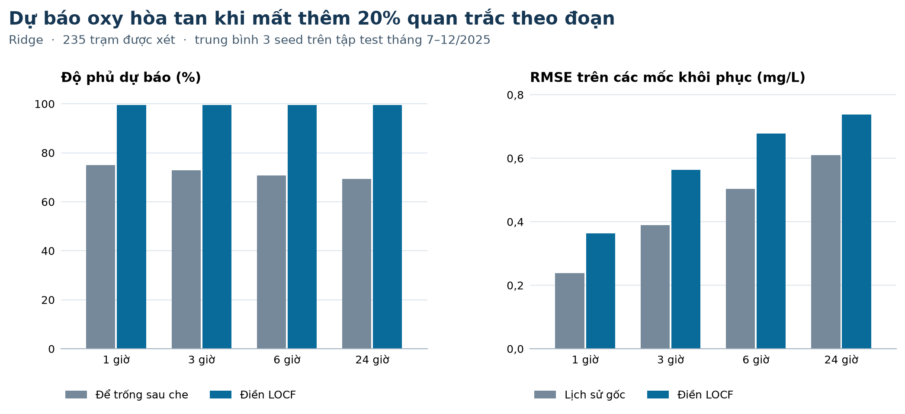

# Lựa chọn mô hình và đánh giá DO

Bộ mô hình chốt trước khi chạy test gồm **LOCF cho điền khuyết DO trong streaming** và **Ridge cho cả bốn khoảng dự báo 1, 3, 6 và 24 giờ**. Kết quả lựa chọn dùng tập validation tháng 1–6/2025. Tập test tháng 7–12/2025 dùng để báo cáo điểm của các mô hình đã chốt.

## Validation điền khuyết DO

Xét kịch bản che theo đoạn liên tục (`missing_type=block`) ở bốn mức thiếu. Với streaming, chỉ xét phương pháp causal. Tiêu chí chính là RMSE thấp, đối chiếu bằng MAE và độ phủ. RMSE và MAE lấy trung bình qua ba seed 42, 43 và 44. Độ phủ là tổng số điểm được chấm chia cho tổng số điểm bị che qua ba seed.

| Phương pháp | Causal | RMSE 5% | RMSE 10% | RMSE 20% | RMSE 30% |
|---|---|---:|---:|---:|---:|
| **LOCF** | Có | **0,5514** | **0,5666** | **0,6039** | **0,6382** |
| Kalman | Có | 0,7557 | 0,7644 | 0,7746 | 0,7882 |
| Iterative | Có | 1,1259 | 1,2051 | 1,3410 | 1,4515 |
| KNN | Có | 1,2390 | 1,3487 | 1,5058 | 1,6487 |
| Linear | Không | 0,5918 | 0,5758 | 0,5872 | 0,5931 |

Mỗi ô trong bảng sau ghi **MAE (mg/L) / độ phủ**.

| Phương pháp | Thiếu 5% | Thiếu 10% | Thiếu 20% | Thiếu 30% |
|---|---:|---:|---:|---:|
| **LOCF** | 0,2925 / 99,95% | 0,3047 / 99,92% | 0,3166 / 99,95% | 0,3275 / 99,94% |
| Kalman | 0,4002 / 99,95% | 0,4039 / 99,92% | 0,4055 / 99,95% | 0,4052 / 99,94% |
| Iterative | 0,7151 / 99,73% | 0,7751 / 99,44% | 0,8689 / 98,47% | 0,9580 / 96,75% |
| KNN | 0,7917 / 99,73% | 0,8637 / 99,44% | 0,9692 / 98,47% | 1,0733 / 96,75% |
| Linear | 0,2738 / 99,85% | 0,2736 / 99,81% | 0,2729 / 99,86% | 0,2712 / 99,88% |

Trong nhóm causal, LOCF có RMSE và MAE thấp nhất ở cả bốn mức thiếu, với độ phủ bằng Kalman. Linear dùng được trong xử lý offline và đạt RMSE thấp hơn LOCF ở mức thiếu 20% và 30%. Lựa chọn LOCF áp dụng cho DO bị thiếu theo đoạn trong streaming. [CSV validation](../../data/report/imputation-valid.csv) · [Bảng tổng hợp Excel](../../data/report/imputation-valid-do-block.xlsx)

## Validation dự báo DO

Chọn mô hình có RMSE thấp nhất tại mỗi khoảng dự báo và đối chiếu MAE. Mỗi ô dưới đây ghi **RMSE / MAE** theo mg/L. Số trạm và số điểm được chấm giống nhau cho cả ba mô hình ở từng khoảng dự báo. Benchmark tính MAE và RMSE gộp theo số điểm được chấm.

| Khoảng dự báo | Persistence | Seasonal Naive | Ridge | Số trạm | Số điểm chấm |
|---|---:|---:|---:|---:|---:|
| 1 giờ | 0,2253 / 0,1135 | 0,5438 / 0,3261 | **0,1608 / 0,0859** | 233 | 3.282.620 |
| 3 giờ | 0,5270 / 0,2825 | 0,5447 / 0,3267 | **0,2880 / 0,1611** | 233 | 3.278.940 |
| 6 giờ | 0,8626 / 0,4786 | 0,5469 / 0,3274 | **0,4039 / 0,2317** | 233 | 3.274.047 |
| 24 giờ | 0,5445 / 0,3263 | 0,5445 / 0,3263 | **0,5311 / 0,3248** | 233 | 3.249.540 |

Ridge có RMSE và MAE thấp nhất ở cả bốn khoảng.

| Khoảng dự báo | Baseline có RMSE thấp nhất | RMSE baseline (mg/L) | RMSE Ridge (mg/L) | Mức giảm RMSE |
|---|---|---:|---:|---:|
| 1 giờ | Persistence | 0,2253 | 0,1608 | 28,64% |
| 3 giờ | Persistence | 0,5270 | 0,2880 | 45,35% |
| 6 giờ | Seasonal Naive | 0,5469 | 0,4039 | 26,14% |
| 24 giờ | Persistence và Seasonal Naive | 0,5445 | 0,5311 | 2,46% |

Mức giảm được tính trên số liệu gốc trước khi làm tròn. [CSV validation](../../data/report/forecast-valid.csv) · [CSV theo trạm](../../data/report/forecast-valid-stations.csv)

## Kết quả test tháng 7–12/2025 trên bộ 235 trạm

Đối chiếu mã trạm trong CSV theo trạm với danh mục cho thấy đủ 235 trạm. Ở cả bốn mức che theo đoạn và ba seed, 230 trạm có ít nhất một điểm DO được chấm cho LOCF. MAE và RMSE là trung bình của ba kết quả gộp theo seed. Độ phủ bằng tổng số điểm chấm được chia cho tổng số điểm bị che. [Danh mục trạm](../../config/stations_large.json) · [CSV điền khuyết](../../data/report/imputation-test.csv) · [CSV theo trạm](../../data/report/imputation-test-stations.csv)

| Mô hình điền khuyết | Tỷ lệ thiếu theo đoạn | RMSE (mg/L) | MAE (mg/L) | Độ phủ |
|---|---:|---:|---:|---:|
| LOCF | 5% | 0,6863 | 0,3607 | 99,85% |
| LOCF | 10% | 0,7423 | 0,3844 | 99,91% |
| LOCF | 20% | 0,7700 | 0,4000 | 99,92% |
| LOCF | 30% | 0,8014 | 0,4137 | 99,90% |

Riêng ở mức thiếu 20%, LOCF điền và chấm được 2.046.792 trong 2.048.388 lượt che qua ba seed. Các lượt che có thể trùng vị trí giữa các seed.

| Mô hình dự báo | Khoảng dự báo | RMSE (mg/L) | MAE (mg/L) | Số trạm | Số điểm chấm | Giảm RMSE so với baseline tốt nhất |
|---|---:|---:|---:|---:|---:|---:|
| Ridge | 1 giờ | 0,2438 | 0,1183 | 229 | 3.370.537 | 23,08% |
| Ridge | 3 giờ | 0,3950 | 0,2059 | 229 | 3.366.701 | 39,21% |
| Ridge | 6 giờ | 0,5106 | 0,2770 | 229 | 3.361.510 | 21,61% |
| Ridge | 24 giờ | 0,6166 | 0,3526 | 229 | 3.336.447 | 5,11% |

Ba mô hình dự báo có cùng số trạm và số điểm chấm ở mỗi khoảng. Baseline có RMSE thấp nhất là Persistence ở 1 giờ, Seasonal Naive ở 3 và 6 giờ. Hai baseline bằng điểm nhau ở 24 giờ. Mức giảm tính từ RMSE trước khi làm tròn. [CSV dự báo](../../data/report/forecast-test.csv) · [CSV theo trạm](../../data/report/forecast-test-stations.csv)

Đối chiếu Silver cho thấy năm trạm `USGS-04183038`, `USGS-07288048`, `USGS-07288068`, `USGS-07288500` và `USGS-07288521` đều thiếu toàn bộ DO trong tập test. Trạm thứ sáu, `USGS-06893100`, có 1.363 quan trắc DO trên test nhưng thiếu toàn bộ DO trong tập train, nên không fit được Ridge riêng cho trạm. [Số quan trắc theo trạm](tables/ridge-scenarios-input-stations.csv) · [Dự báo theo trạm](../../data/report/forecast-test-stations.csv)

### Sai số dự báo test theo loại thủy vực

Ghép mã trạm trong CSV Ridge với `site_type` của danh mục 235 trạm. RMSE mỗi nhóm bằng căn bậc hai của tổng `n_scored × rmse²` theo trạm chia cho tổng `n_scored`, đơn vị mg/L. Số trạm chấm được của từng nhóm giống nhau ở cả bốn khoảng dự báo. [Kết quả Ridge theo trạm](../../data/report/forecast-test-stations.csv) · [Danh mục USGS](../../config/stations_large.json)

| Loại thủy vực | Trạm chấm được / danh mục | RMSE 1 giờ | 3 giờ | 6 giờ | 24 giờ |
|---|---:|---:|---:|---:|---:|
| Sông, suối (Stream) | 195 / 201 | 0,2143 | 0,3588 | 0,4756 | 0,5907 |
| Sông chịu triều | 13 / 13 | 0,2641 | 0,3740 | 0,4316 | 0,3552 |
| Hồ và hồ chứa | 10 / 10 | 0,5541 | 0,8614 | 1,0679 | 1,2651 |
| Cửa sông | 9 / 9 | 0,2978 | 0,4375 | 0,5079 | 0,5055 |
| Kênh | 1 / 1 | 0,1502 | 0,2259 | 0,2930 | 0,4338 |
| Nguồn nước (Spring) | 1 / 1 | 0,0163 | 0,0280 | 0,0419 | 0,0921 |

Trong mẫu test này, nhóm hồ và hồ chứa có RMSE cao nhất ở cả bốn khoảng. Hai nhóm chỉ có một trạm mô tả kết quả tại riêng trạm đó.

## Đánh giá ảnh hưởng của điền khuyết lên dự báo

Thí nghiệm trên tập test tháng 7–12/2025 che DO theo đoạn ở mức 10% với ba seed 42, 43 và 44. Với mỗi trạm và khoảng dự báo, hai phương pháp dùng cùng mô hình Ridge đã huấn luyện, cùng mặt nạ thiếu và cùng thời điểm chấm. Kết quả gồm 229 trạm ở mỗi tổ hợp seed và khoảng dự báo. [Mã thí nghiệm](../../benchmarks/bench_imputation_impact.py)

Các giá trị trong bảng là trung bình qua ba seed, đơn vị mg/L. ΔRMSE bằng RMSE Kalman trừ RMSE LOCF.

| Khoảng dự báo | RMSE LOCF | RMSE Kalman | ΔRMSE | MAE LOCF | MAE Kalman |
|---|---:|---:|---:|---:|---:|
| 1 giờ | 0,333279 | 0,387722 | +0,054443 | 0,149137 | 0,165025 |
| 3 giờ | 0,458745 | 0,497720 | +0,038975 | 0,235776 | 0,253512 |
| 6 giờ | 0,560119 | 0,597888 | +0,037769 | 0,303619 | 0,323582 |
| 24 giờ | 0,655649 | 0,682597 | +0,026948 | 0,372357 | 0,386978 |

LOCF đạt RMSE và MAE thấp hơn Kalman ở cả bốn khoảng trong kịch bản thiếu theo đoạn 10%. ΔRMSE dương ở cả 12 tổ hợp seed và khoảng dự báo. Chênh lệch RMSE trung bình lớn nhất ở 1 giờ và nhỏ nhất ở 24 giờ. [CSV kết quả theo seed](tables/ridge-imputation-impact-test.csv)

## Thí nghiệm ba kịch bản trên 235 trạm (TV4.4)

Câu hỏi là khi mất thêm 20% quan trắc DO theo đoạn, điền LOCF khôi phục được bao nhiêu dự báo và các dự báo đó sai lệch bao nhiêu. Spark xét toàn bộ danh mục 235 trạm, huấn luyện Ridge riêng cho từng trạm và từng khoảng dự báo trên 2023–2024, rồi giữ nguyên mô hình cho ba kịch bản. Chạy trên test tháng 7–12/2025, với seed 42, 43, 44. Mỗi seed dùng chung một mặt nạ cho hai kịch bản có che. [Mã benchmark](../../benchmarks/bench_forecast_scenarios.py)

| Kịch bản trong CSV | Lịch sử DO đưa vào cùng mô hình Ridge |
|---|---|
| `original` | Giữ các quan trắc và khoảng thiếu tự nhiên của Silver. |
| `masked` | Che thêm 20% điểm DO quan sát được theo đoạn và giữ các ô trống. Ridge chỉ phát dự báo khi đủ đặc trưng. |
| `locf` | Điền chính lịch sử đã che bằng LOCF của pipeline, chỉ dùng dữ liệu đến thời điểm phát dự báo. |

Phát dự báo vào đầu mỗi giờ UTC, ở 1, 3, 6 và 24 giờ. Lịch sử bắt đầu từ đầu tập test. Mẫu số `n_targets` giống nhau giữa ba kịch bản trong mỗi seed và khoảng dự báo, chỉ gồm mốc đích có DO thật và nằm ngoài mặt nạ. Bảng dự báo chính ở trên dùng các mốc phát cách nhau 15 phút và cách chuẩn bị lịch sử của benchmark gốc.

### Kết quả ba kịch bản

Ba phần Parquet xuất từ Silver khớp đủ 235 mã trạm của danh mục, gồm 16.491.360 dòng train và 4.151.040 dòng test. Cả hai tập dùng lưới 15 phút liên tục theo từng trạm. Trong 4.151.040 dòng test có 3.413.981 quan trắc DO. Bản chạy ngày 28/11/2026 dùng mã `41d26fb`, Spark `local[4]` trên một máy cloud, đọc Parquet trên đĩa, mất khoảng 41 giây cho lệnh benchmark. Các bảng dưới lấy trung bình số học của ba seed. Trong từng seed, mỗi cặp dự báo–quan trắc đóng góp như nhau vào chỉ số gộp. [CSV tổng hợp 36 dòng](tables/ridge-scenarios-test.csv) · [CSV theo trạm 8.460 dòng](../../data/report/ridge-scenarios-test-stations.csv) · [Kiểm kê Silver](tables/ridge-scenarios-input-stations.csv)

| Khoảng dự báo | Độ phủ gốc | Độ phủ sau che, để trống | Độ phủ sau che, điền LOCF | Tăng so với để trống (điểm %) | Dự báo thêm mỗi seed (TB) |
|---|---:|---:|---:|---:|---:|
| 1 giờ | 98,05% | 74,98% | 99,50% | 24,52 | 179.074 |
| 3 giờ | 97,94% | 72,90% | 99,50% | 26,60 | 194.181 |
| 6 giờ | 97,87% | 70,71% | 99,49% | 28,78 | 209.976 |
| 24 giờ | 97,74% | 69,40% | 99,44% | 30,04 | 218.470 |

Tại mỗi khoảng và seed, dữ liệu gốc và dữ liệu che để trống đều cho dự báo chấm được ở 227 trạm. LOCF đưa con số này lên 228. So với 229 trạm ở benchmark 15 phút, trạm `USGS-07380249` chỉ có DO test ở phút 15 và 45 nên thiếu đích để chấm vào đầu giờ. Riêng `USGS-444306122144600` có đích đầu giờ, nhưng chỉ đủ lịch sử để dự báo sau khi điền LOCF. LOCF cũng điền các khoảng thiếu tự nhiên trong lịch sử, nên độ phủ có thể vượt kịch bản gốc. [Kết quả từng trạm](../../data/report/ridge-scenarios-test-stations.csv)

**Sai số trên tất cả dự báo chấm được của từng kịch bản (MAE / RMSE, mg/L)**

| Khoảng dự báo | Gốc | Sau che, để trống | Sau che, điền LOCF |
|---|---:|---:|---:|
| 1 giờ | 0,1136 / 0,2323 | 0,1138 / 0,2305 | 0,1289 / 0,2738 |
| 3 giờ | 0,1984 / 0,3785 | 0,1983 / 0,3749 | 0,2275 / 0,4398 |
| 6 giờ | 0,2676 / 0,4909 | 0,2670 / 0,4859 | 0,3019 / 0,5566 |
| 24 giờ | 0,3427 / 0,5998 | 0,3410 / 0,5956 | 0,3703 / 0,6529 |

Mỗi cột trên chấm cả những thời điểm riêng mà kịch bản đó phát được dự báo. Để so chất lượng trên cùng thời điểm, bảng dưới dùng hai nhóm mốc đối chiếu.

| Khoảng dự báo | Mốc khôi phục so được với gốc mỗi seed (TB) | RMSE gốc trên các mốc này | RMSE LOCF trên các mốc này | MAE LOCF trên các mốc này | RMSE trên mốc chung cả ba |
|---|---:|---:|---:|---:|---:|
| 1 giờ | 168.430 | 0,2378 | 0,3632 | 0,1692 | 0,2305 |
| 3 giờ | 182.779 | 0,3889 | 0,5633 | 0,2984 | 0,3749 |
| 6 giờ | 198.063 | 0,5035 | 0,6781 | 0,3768 | 0,4859 |
| 24 giờ | 205.990 | 0,6101 | 0,7373 | 0,4253 | 0,5956 |

Các sai số có đơn vị mg/L. “Dự báo thêm” đếm mọi mốc LOCF phát được mà kịch bản để trống bỏ qua. Bảng sai số xét phần trong số đó mà lịch sử gốc cũng phát được dự báo để có cùng trạm, mô hình và thời điểm đối chiếu. Số mốc được làm tròn đến đơn vị sau khi lấy trung bình ba seed.

**Kết luận.** Lợi ích đo được của LOCF là tăng độ phủ ở cả bốn khoảng, mạnh nhất ở 24 giờ (+30,04 điểm phần trăm). Ở các mốc cả ba cùng dự báo được, các đặc trưng Ridge giống nhau và sai số cũng bằng nhau. Ở các mốc khôi phục so được với lịch sử gốc, dùng LOCF cho RMSE cao hơn lịch sử gốc ở cả bốn khoảng. Ở 24 giờ, cặp RMSE tương ứng là 0,7373 và 0,6101 mg/L. [Kết quả theo seed](tables/ridge-scenarios-test.csv)



### Tái lập trên cụm HDFS và Spark

Lệnh dưới đây dùng Silver trong cấu hình `.env.bigdata` và hai Spark worker của cụm. Kết quả gộp được ghi vào `docs/report/tables/ridge-scenarios-test.csv`, kết quả từng trạm vào `data/report/ridge-scenarios-test-stations.csv`.

```powershell
docker compose --env-file .env.bigdata run --rm --no-deps data-init python -m benchmarks.bench_forecast_scenarios --master spark://spark-master:7077
```

Đọc kết quả theo từng seed và khoảng dự báo.

- `n_stations_considered` là số trạm trong danh mục đã được xét. `n_stations_scored` đếm những trạm có ít nhất một dự báo chấm được. `coverage = n_scored / n_targets`. Lấy `n_scored(locf) − n_scored(masked)` để biết số dự báo LOCF khôi phục thêm.
- `mae` và `rmse` tính trên mọi dự báo chấm được của từng kịch bản. `mae_common` và `rmse_common` dùng các thời điểm cả ba cùng phát được dự báo. Ở các mốc chung, các đặc trưng đều có quan trắc nên ba đầu vào Ridge giống nhau.
- `n_recovered_pair` đếm các mốc mà `original` và `locf` dự báo được còn `masked` bỏ qua. So `rmse_recovered` và `mae_recovered` giữa `original` và `locf` trên chính các mốc này để đo tổn thất do mất lịch sử quan trắc. Sai số có đơn vị mg/L. Ô trống nghĩa là không có cặp để tính.

## Kiểm tra Ridge trên luồng phục vụ

Bộ xuất mô hình dùng Spark `local[4]` để đọc 235 trạm và chỉ fit trên giai đoạn 01/01/2023–31/12/2024. Có 233 trạm đủ dữ liệu ở cả bốn khoảng, tương ứng 932 bộ hệ số. Hai trạm `USGS-04183038` và `USGS-06893100` thiếu toàn bộ DO trong train. Mỗi mô hình dùng đúng bộ đặc trưng, StandardScaler và Ridge của thí nghiệm. Cấu hình Big Data dùng LOCF để điền lịch sử và nạp cùng bộ hệ số Ridge trong streaming và API. [Hệ số Ridge](../../models/forecaster_ridge_235.csv) · [Lệnh huấn luyện và kiểm tra](../../models/README.md)

Trên cửa sổ ba ngày cuối test, bộ kiểm tra nạp mô hình, điền lịch sử rồi phát dự báo một lần tại mốc mới nhất mỗi trạm. 196/235 trạm có đủ điều kiện ở thời điểm đó. Kết quả có đủ 60/180/360/1440 phút, đúng `target_ts` và hữu hạn. Phần `predict` mất trung bình 2,5 ms trên mỗi trạm được xét, tính cả trạm bỏ qua. Số 196 là độ phủ tại một thời điểm. Con số 228 trạm ở TV4.4 là số trạm có ít nhất một lần được chấm trong cả kỳ theo kịch bản LOCF.

**Replay tích hợp.** Trên một máy cloud, phát lại 566 bản ghi DO thật của hai trạm Connecticut River (`USGS-01184000`) và Illinois River (`USGS-05586300`) trong 01–03/07/2025 qua Kafka, dùng Spark Structured Streaming `local[2]` và một cơ sở dữ liệu PostgreSQL riêng. Tại hai thời điểm phát dự báo, API theo yêu cầu và `/predictions/latest` trả cùng bốn giá trị Ridge cho mỗi trạm (chênh lệch dưới 10⁻⁹ mg/L). Khi dữ liệu ngày sau đến, `/predictions/accuracy` chấm được cả bốn khoảng ở hai trạm. Ví dụ, tại `USGS-01184000` lúc 23:45 UTC ngày 02/07, Ridge dự báo DO sau 1 giờ là 8,1255 mg/L, quan trắc sau đó là 8,1 mg/L. [Tám cặp dự báo–quan trắc từ PostgreSQL](tables/ridge-stream-predictions.csv)

| Micro-batch | Bản ghi | Kafka gửi → ghi xong quan trắc p50 / p95 | Xử lý ML của batch |
|---|---:|---:|---:|
| Đợt 1 | 374 | 4,90 / 5,23 giây | 3,24 giây |
| Đợt 2 | 192 | 1,84 / 2,01 giây | 0,54 giây |

p50/p95 tính riêng cho mỗi đợt, từ thời điểm producer gửi đến khi ghi xong quan trắc trong PostgreSQL. Sau thời điểm này, phần ML đọc lịch sử, điền khuyết, dự báo và ghi kết quả. Phép thử có hai trạm và hai micro-batch có dữ liệu, phục vụ kiểm tra tích hợp. Số đo tải lớn của hệ thống được ghi riêng trong chương hiệu năng. [CSV độ trễ](tables/ridge-stream-latency.csv)
