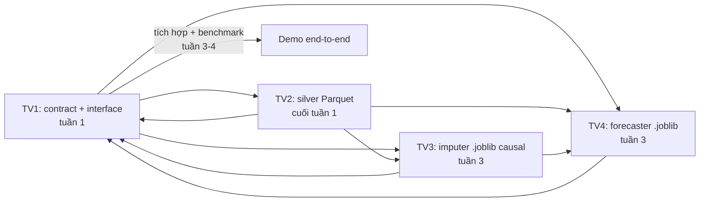

# Phân công & kế hoạch 4 tuần

Nguyên tắc (học từ BKByte, Phụ lục A tr. 90–91): **mỗi người làm chủ một phần có thể kiểm chứng**
(code riêng + số liệu riêng), và **bốn phần ghép thành một hệ thống chạy được**. Điểm ghép nối là
data contract ([`data_contract.md`](data_contract.md)) và interface mô hình (`wq/models/base.py`) do TV1 chốt ở tuần 1.

## 1. Phân công chi tiết

| | TV1 (bạn) – Trưởng nhóm | TV2 | TV3 | TV4 |
|---|---|---|---|---|
| Vai trò | System Architecture, Streaming, Integration & Deployment | Data Engineering, Spark Batch & Water Quality Monitoring | Missing Data Imputation & Evaluation | Water Quality Prediction & Model Evaluation |
| Code sở hữu | `wq/contracts.py`, `wq/models/base.py`, `registry.py`, `ingestion/replay_producer.py`, `streaming/`, `api/`, `docker-compose.yml`, `docker/`, `deploy/`, `benchmarks/` | `ingestion/download_usgs.py`, `batch/`, trang giám sát trong `dashboard/`, `notebooks/eda_*` | `wq/models/imputers_*.py`, `notebooks/imputation_*`, `wq/evaluation.py` (phần imputation) | `wq/models/forecasters_*.py`, `notebooks/forecast_*` |
| Việc chính | Chốt kiến trúc + contract; Kafka producer; Spark Structured Streaming (QC, watermark, dedup, window, sink, ML online); FastAPI; Docker Compose; giám sát pipeline; benchmark hiệu năng; tích hợp model của TV3/TV4; điều phối, review PR | Chọn trạm, tải dữ liệu; ETL raw→bronze→silver→gold; QC nâng cao (spike, flatline, qualifier USGS); thống kê thiếu dữ liệu (tỉ lệ, độ dài khoảng trống); EDA; WQI & luật cảnh báo; trang dashboard giám sát | Thiết kế thí nghiệm che dữ liệu (5/10/20/30%, ngẫu nhiên vs liên tục); cài ≥ 4 phương pháp (LOCF, nội suy, KNN/MICE, Kalman/DBN…); đánh giá MAE/RMSE/R²; xuất model causal cho streaming | Đặc trưng thời gian (lag, rolling, giờ trong ngày); XGBoost + LSTM (hoặc 1 mô hình học sâu); so sánh với baseline; thí nghiệm dự báo trên dữ liệu gốc / thiếu / đã impute; xuất model cho streaming |
| Sản phẩm bàn giao | Hệ thống chạy bằng 1 lệnh; sơ đồ kiến trúc; bảng benchmark batch & streaming + biểu đồ; video/kịch bản demo | Dataset silver + báo cáo chất lượng dữ liệu; notebook EDA; biểu đồ missingness | Bảng MAE/RMSE/R² theo phương pháp × tỉ lệ thiếu × kiểu thiếu; `imputer_*.joblib` | Bảng sai số theo mô hình × horizon × kịch bản dữ liệu; biểu đồ dự báo; `forecaster_*.joblib` |
| Báo cáo | Ch.1, Ch.4 (kiến trúc, streaming, triển khai), Ch.5 (hiệu năng), Ch.6; ghép & biên tập toàn bộ | Ch.3 (bài toán & dữ liệu), Ch.4 (ETL) | Ch.2 (tổng quan imputation, bài báo 2), Ch.4/5 (imputation) | Ch.2 (dự báo chuỗi thời gian, bài báo 1), Ch.4/5 (prediction) |
| Tỉ trọng | 25% | 25% | 25% | 25% |

## 2. Giao diện giữa các module (ai đưa gì cho ai)

## 3. Lịch 4 tuần

| Tuần | TV1 | TV2 | TV3 | TV4 | Mốc chung (cuối tuần) |
|---|---|---|---|---|---|
| 1 | Chốt kiến trúc, contract, interface; repo + Docker Compose; walking skeleton chạy end-to-end với baseline | Chọn trạm, tải dữ liệu, ETL silver, thống kê thiếu dữ liệu | Đọc bài báo (2), thiết kế thí nghiệm che dữ liệu, code hàm che + metric | Đọc bài báo (1), baseline persistence/seasonal-naive trên split chuẩn | **Hệ thống chạy được bằng `docker compose up`; silver dataset đã chốt** |
| 2 | Hoàn thiện streaming: late/duplicate, window, alert, metrics listener; FastAPI; test khôi phục sau sự cố | QC nâng cao, EDA, WQI, trang dashboard giám sát | Cài và đánh giá các phương pháp offline | Feature engineering, XGBoost, LSTM | Bảng kết quả sơ bộ imputation & prediction |
| 3 | Tích hợp model TV3/TV4 vào streaming + API; chạy benchmark batch & streaming | Hỗ trợ dữ liệu cho benchmark (scale), hoàn thiện ch.3 | Xuất imputer causal; thí nghiệm "impute có giúp dự báo tốt hơn?" cùng TV4 | Xuất forecaster; thí nghiệm dự báo trên dữ liệu gốc/thiếu/đã impute | **Demo end-to-end với model thật** |
| 4 | Viết ch.1, 4, 5 (hiệu năng), 6; ghép báo cáo; slide; tập demo | Viết ch.3, phần ETL | Viết phần imputation | Viết phần prediction | **Nộp báo cáo + slide + video demo** |

## 4. Quy trình làm việc

- Mỗi người làm trên nhánh riêng (`tv2/2.2a-qc`, `tv3/3.1-giao-thuc-che`…), mở Pull Request vào `thang/TV1`; bot review thay
  TV1 và merge khi đạt tiêu chí. Việc, tiêu chí đạt và trạng thái: [`TEAM_TASKS.md`](TEAM_TASKS.md).
- Trước khi mở PR: `make test` phải pass; không commit dữ liệu (`data/` đã trong `.gitignore`).
- Model bàn giao kèm: file `.joblib`, notebook tái lập, bảng số liệu (CSV) và 3–5 dòng mô tả trong `models/README.md`.
- Họp ngắn 2 lần/tuần (15 phút): mỗi người nói đã xong gì, vướng gì, cần ai.

## 5. Ma trận thí nghiệm (chương 5)

| Nhóm | Biến số | Chỉ số | Người chạy |
|---|---|---|---|
| Imputation | Phương pháp × tỉ lệ thiếu (5/10/20/30%) × kiểu thiếu (ngẫu nhiên / khối liên tục) × biến | MAE, RMSE, R² **chỉ trên ô bị che có giá trị thật** | TV3 |
| Prediction | Mô hình × horizon (1h/3h/6h/24h) × dữ liệu (gốc / còn thiếu / đã impute) | MAE, RMSE, (MAPE) trên split test | TV4 |
| Big Data Performance | Batch: kích thước dữ liệu × số core × local/cluster, so với pandas. Streaming: tốc độ phát × số core, có/không ML | values/s, thời gian, rows/s, độ trễ p50/p95 | TV1 |

Nguyên tắc chống rò rỉ dữ liệu: chia theo thời gian; fit mọi thứ (chuẩn hóa, imputer) trên train; chỉ đánh giá
imputation trên giá trị thật bị che đi; không dùng thông tin test khi huấn luyện hoặc impute trước khi đánh giá dự báo.
